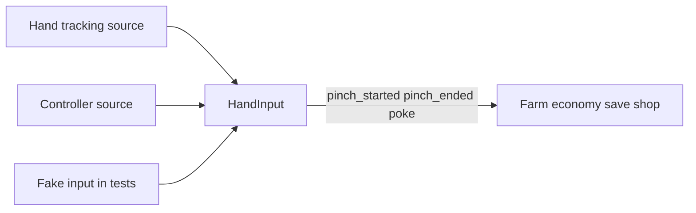

# Architecture — RanchVille

This document is the system shape for later issues: folders, autoloads, data resources, signals, and input abstraction. Repo rules, naming, never-touch files, and the headless test command live in [AGENTS.md](AGENTS.md). Do not contradict AGENTS.md; link it instead.

MVP loop on Quest 3: plant, water, and harvest by hand; sell crops; buy crops and decorations; save and load.

Linear project: [RanchVille](https://linear.app/biccs/project/ranchville-d13837b7f800).

## Folder roles

The repo root is the Godot project root.

| Path | Role |
|------|------|
| `addons/` | Godot plugins (Meta OpenXR Vendors, gdUnit4, etc.) |
| `art/` | Art direction, asset shortlists, design notes |
| `audio/` | SFX, music, `licenses.md` |
| `resources/` | Data resources (e.g. CropData `.tres`) |
| `scenes/` | Game and UI `.tscn` files |
| `scripts/` | GDScript game logic, managers, components |
| `store/` | Horizon Store copy, icons, screenshots |
| `tasks/` | Agent task notes (`todo.md`, lessons) |
| `tests/` | Headless unit and integration tests |

Planned subfolders (created when their issues land; not required for BIC-12):

| Path | Role |
|------|------|
| `scripts/input/` | `HandInput`, fake input, pinch detector, controller mapping |
| `scripts/farm/` | Soil tile state machine, `CropGrowth`, `FakeClock` |
| `scripts/economy/` | `CoinManager` |
| `scripts/save/` | Versioned JSON save/load |
| `scripts/audio/` | `AudioManager` |
| `resources/crops/` | `CropData` `.tres` files |

## Planned autoloads

Register these in `project.godot` only when their issues implement them. Names and jobs are fixed here so later code shares one shape.

| Autoload | Job |
|----------|-----|
| **HandInput** | Signal bus for player actions. Sources: hand tracking, controllers, fake input in tests. |
| **CoinManager** | Coin balance. `add(n)` and `spend(n)`; reject when funds are short or amount is negative. |
| **GrowthSystem** | Advance watered crops using `CropData` growth time. Headless tests inject a fake clock. |
| **SaveManager** | Read and write versioned JSON under `user://`. Payload: version, coins, unlocks, tile/crop state. Corrupt JSON or unknown version fails clean or resets to a documented default. |
| **AudioManager** | Play named SFX and a music bus. Hooks: plant, water, harvest, sell, UI click. Missing files log and skip; they do not crash. |

These are not autoloads: soil tile instances, `Grabbable`, shop UI, unlock rules. Unlock rules stay in data, not in scenes. Settings (volume, input mode, comfort) persist through save or settings keys when those issues land; they do not need a separate autoload in MVP.

## Data resources (crops and economy)

### CropData

Class: `CropData`. Files: `resources/crops/*.tres` (e.g. `wheat_crop.tres`).

Implemented (BIC-24):

- `crop_id` and an ordered `stages` array of `CropStage` resources
- Each `CropStage` has `id`, `duration_sec`, placeholder `mesh`, and `harvest_ready` (exactly one stage, on the last)
- At least three visible growth stages, including harvest-ready

Still planned in later issues:

- Aggregate growth time, seed cost, and sell price ([BIC-29](https://linear.app/biccs/issue/BIC-29/cropdata-resource-growth-time-prices-models))
- Final art model paths when import lands

**CropGrowth** (`scripts/farm/crop_growth.gd`) is a headless-testable helper: it advances elapsed time only after `water()`, maps time to stage index, and exposes `is_harvest_ready()`. It is not an autoload. **GrowthSystem** timers and session wiring remain [BIC-27](https://linear.app/biccs/issue/BIC-27/growthsystem-with-timers-unit-tested).

**FakeClock** (`scripts/farm/fake_clock.gd`) advances test time; **GrowthSystem** tests will reuse it.

Prices and growth data live on the resource, not in `.tscn` files.

### Economy runtime

`CoinManager` holds the running balance. Sell bin and shop read `CropData` sell and seed prices and call `CoinManager.add` / `CoinManager.spend`.

### Save payload

JSON only (not binary). Includes save version, coins, unlocks, and tile/crop state. Path under `user://`, not `res://`.

### Later resources (name only)

Upgrade data and decoration data will be separate resources when their issues ship. Field design is out of scope for this document.

## Input abstraction

Game logic for crops, economy, save/load, soil tiles, and shop must not import OpenXR types.

**HandInput** exposes Godot signals:

- `pinch_started`
- `pinch_ended`
- `poke`

**PinchDetector** (`scripts/input/pinch_detector.gd`) is headless-testable pure geometry: thumb-tip and index-tip `Vector3` positions in, pinched or not out. Threshold: `PinchDetector.PINCH_DISTANCE_M` (meters); pinched when tip distance is less than or equal to that value (inclusive boundary). `apply()` emits `pinch_started` / `pinch_ended` on **HandInput** only when state changes. A future XR adapter under `scripts/input/` will read joints and call `apply()`; it may use OpenXR. Controller trigger or grip maps to pinch start/end; a documented button or poke pose maps to `poke`. All gameplay code subscribes to **HandInput** only.

Tests use a fake input helper that emits the same signals without a headset.

**HandInput** also exposes `active_hand` (`&"left"` or `&"right"`). XR and fake sources set it before each pinch emit so grab logic knows which holder to use.

**HandInputXr** (`scripts/xr/hand_input_xr.gd`) maps `XRController3D` `trigger_click` press and release on the scene left/right hand trackers to **HandInput** pinch start/end. OpenXR types stay under `scripts/xr/` only.

## Grab (BIC-19)

**Grabbable** (`scripts/grab/grabbable.gd`) is a `Node3D` component (group `grabbable`). Export `grab_range_m` (default 0.28 m). `grab(holder)` reparents to the hand or controller holder and keeps world pose. `release()` restores the original parent and keeps world pose. No RigidBody physics in MVP.

**GrabSelector** (`scripts/grab/grab_selector.gd`) is headless-testable: `pick_nearest(origin, range_m, nodes)` and `pick_nearest_grabbable(origin, nodes)` (per-object range from each **Grabbable**).

**GrabSystem** (`scripts/grab/grab_system.gd`) listens to **HandInput** pinch signals. On pinch start it picks the nearest in-range **Grabbable** for `active_hand` and attaches it to the matching scene holder. Pinch end releases only that hand’s hold.

Debug props: gray **Marker** (`MeshInstance3D`, table placement) stays a mesh so **TableAnchor** can restyle it. Two orange **Grabbable** cubes sit on FarmRoot. In-range targets show a solid yellow outline before pinch.

**HandInteractionPoint** (`scripts/xr/hand_interaction_point.gd`) on each hand’s `InteractionPoint` child tracks the index tip for grab range. **HandInputXr** reads hand-joint pinch via **PinchDetector**, and falls back to controller `trigger` / `trigger_click`. `project.godot` references `openxr_action_map.tres` for Quest actions.

## Table anchor and FarmRoot (BIC-18)

**FarmRoot** (`scenes/xr_empty.tscn`) is the play-space origin for soil tiles and props. Later gameplay parents under FarmRoot, not under the XR camera.

**TableAnchor** (`scripts/xr/table_anchor.gd`) uses Meta **OpenXRFbSceneManager** when Scene API is enabled. If a `table` semantic label exists, FarmRoot parents to that scene anchor’s **XRAnchor3D** so the farm tracks the real surface. If scene data is missing, capture fails, or no table is found, **manual place mode** follows the active controller until the player confirms with trigger (or **HandInput** `poke`). Manual placement locks FarmRoot in world space on the scene root.

**TableAnchorPicker** (`scripts/xr/table_anchor_picker.gd`) is headless-testable: table label matching and nearest-table choice. OpenXR types stay under `scripts/xr/` only; farm, economy, and input scripts do not import them.

## Headless-testable systems

This is a hard rule:

Crops, economy, and save/load stay in plain GDScript and Godot resources. They stay headless-testable. They do not import OpenXR.

The same rule applies to soil tile logic, `GrowthSystem`, `CropData`, and pinch-detector math (pure input geometry).

Unit and integration tests live in `tests/`. After BIC-10, run the gdUnit4 command documented in [AGENTS.md](AGENTS.md) before moving an issue to **In Review**.

## Open decisions

**In-session vs offline growth** ([BIC-34](https://linear.app/biccs/issue/BIC-34/decide-in-session-timers-only-vs-offline-progression)): not decided. Do not implement offline catch-up until that issue is approved. After approval, record the choice in this section. `GrowthSystem` must follow the approved path only.
